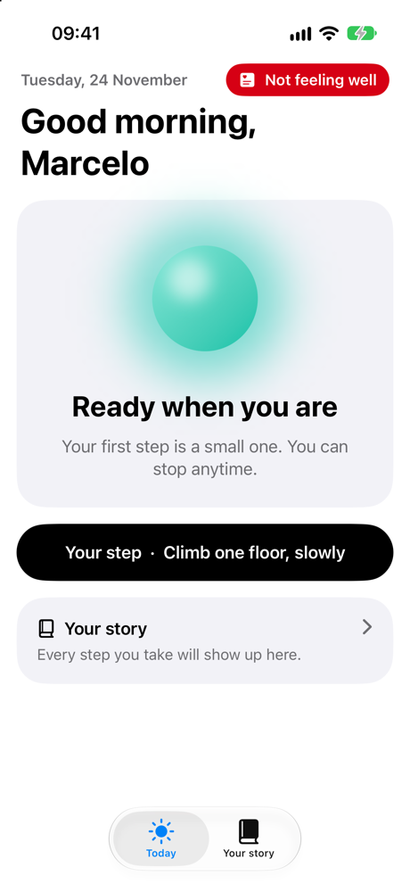
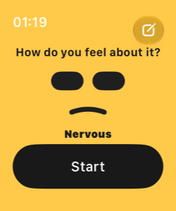
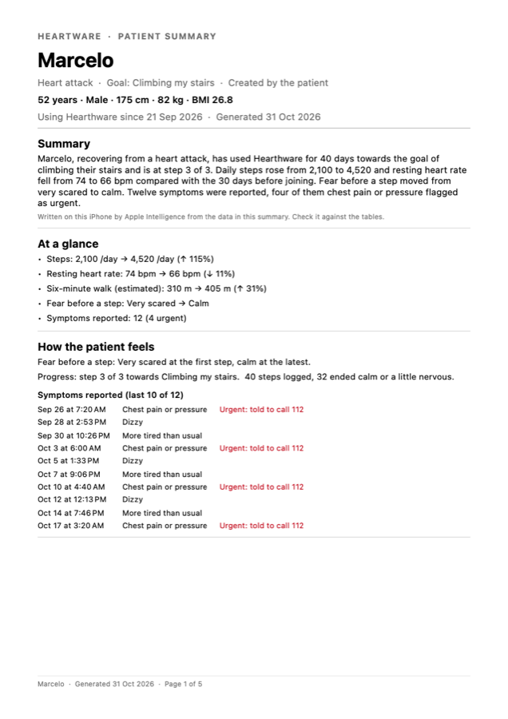
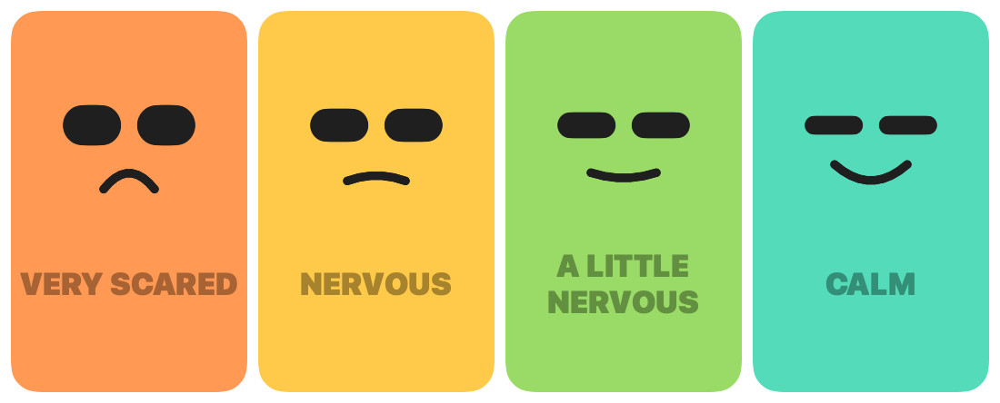
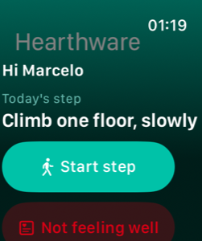
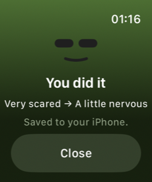
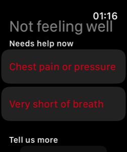
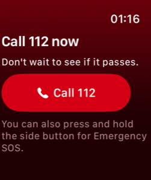
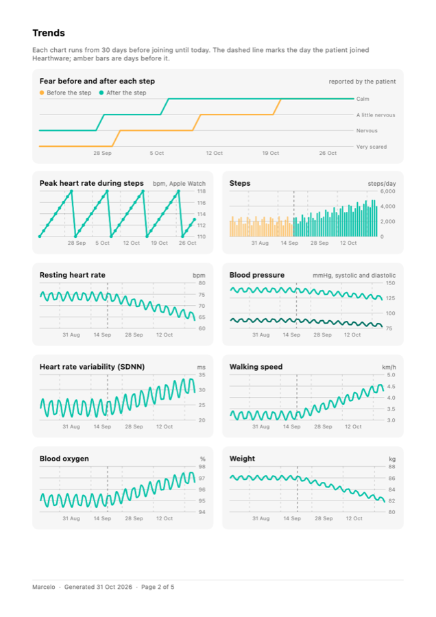
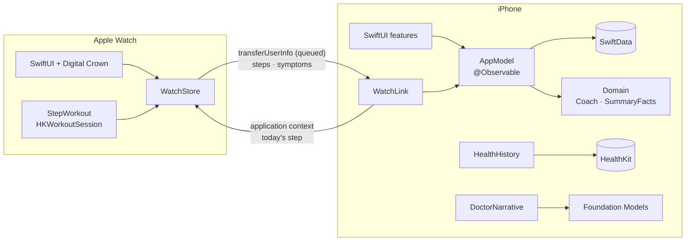

<p align="center">
  
</p>

<h1 align="center">Heartware</h1>

<p align="center">
  <b>An iPhone and Apple Watch app that helps heart patients get their life back, one small step at a time. Their cardiologist gets the data.</b>
</p>

<p align="center">
  
  
  
  
</p>

<p align="center">
  
  &nbsp;
  
  &nbsp;
  
</p>

---

## The problem

After a heart attack, heart surgery or a new diagnosis, many patients become afraid of their own heart. Climbing the stairs, walking to the market or playing with the grandkids starts to feel dangerous, so they stop. That fear is a recognised barrier to recovery. Meanwhile, the cardiologist sees the patient for a few minutes every few weeks and has to piece together what happened in between.

## What Heartware does

| For the patient | For the doctor |
|---|---|
| Turns the goal they want back ("Climbing my stairs") into a **ladder of small steps** | A **multi-page PDF**, shared from the phone with one tap |
| Asks how they feel **before and after each step**, as a face, a colour and a word, **never a number** | **Trends from Apple Health:** 30 days before the patient joined vs. now, with Swift Charts |
| **Apple Watch** keeps them company during the step and measures the heart rate and how fast it recovers | **26 metrics:** heart rate, HRV, blood pressure and mean arterial pressure, SpO₂, VO₂ max, AFib burden, rhythm alerts, walking asymmetry, six-minute walk, weight… |
| **Not feeling well?** Chest pain goes straight to the emergency number; anything else is logged, with a check-in an hour later | **An opening paragraph written on device** by Apple Intelligence, checked against the data before it is used |

<p align="center">
  
  <br><sub>Fear as a face, not a score. The same component runs on the iPhone (slider) and the Watch (Digital Crown).</sub>
</p>

### On the Apple Watch

Everything can be reported from the wrist. The design follows the watchOS Human Interface Guidelines: short interactions, large type, the **Digital Crown** to pick a feeling with one haptic detent per step, and dictation or Scribble for notes.

<p align="center">
  
  
  
  
  
</p>

### The doctor summary

<p align="center">
  
  
  <br><sub>Rendered with sample data.</sub>
</p>

## Engineering highlights

- **On-device generative AI, with a guardrail.**
  - The opening paragraph of the PDF comes from Apple's **Foundation Models** framework, running on the iPhone.
  - In testing, the model invented a patient's age. Now every number in its output must appear in the facts it was given (`SummaryFacts.isGrounded`). Otherwise it retries once, then ships the PDF **without** a paragraph rather than with a wrong one.
  - No health data leaves the phone.
- **Two apps, one source of truth.**
  - The iPhone owns all data in **SwiftData**; the Watch keeps nothing of its own.
  - Watch reports travel over **WatchConnectivity** with `transferUserInfo`. That is a queued, guaranteed delivery, so a step logged on a run with the iPhone at home is saved when they reconnect, with the Watch's original timestamp.
  - Every step carries an id, so a late result from a cancelled step can never land on the wrong record.
- **Deep HealthKit integration.**
  - Statistics and statistics-collection queries (daily series for the charts).
  - Characteristics (age, biological sex), category events (irregular rhythm, high and low heart rate alerts) and ECGs.
  - A **live workout session** on the Watch that measures peak heart rate and **heart-rate recovery**: the seconds until the heart is back within 10 bpm of its starting rate.
- **A real document pipeline in SwiftUI.**
  - SwiftUI views rendered with `ImageRenderer` into a multi-page A4 PDF.
  - Pages adapt to the data: a trends page only when there is something to chart, and steps tables paginated by how much room each row takes.
  - The in-app preview is an image of the same pages, so what the patient sees is exactly what the doctor gets.
- **Modern Swift concurrency.**
  - MainActor-by-default isolation.
  - `nonisolated`, `Sendable` value types for everything that crosses targets or threads.
  - `async` HealthKit and Foundation Models APIs.
- **Accessible by default.**
  - VoiceOver reads feelings as words and adjusts them one at a time.
  - Dynamic Type layouts that scroll instead of clipping.
  - Respects Reduce Motion; haptics on every selection.
- **Tested domain logic.**
  - Everything that decides something is pure Swift: the step ladder, the PDF facts, pagination, message encoding, onboarding validation.
  - Covered by **100+ assertions** in `Checks/`, which compile against the real sources and run in seconds.

## Architecture



- **`AppModel`** is the single source of truth the views observe, and the only place that writes.
- **`Domain/`** holds pure, testable logic: the step ladder (`Coach`), the PDF facts (`SummaryFacts`), the metric definitions (`HealthMetric`) and the body profile (`BodyProfile`).
- **`Services/`** wraps the frameworks: HealthKit, WatchConnectivity, notifications and Foundation Models.
- **`Shared/`** is compiled into both apps: `Feeling`, the face and its colours, the symptom list and the message formats.

```
Hearthware/                  iPhone app
  App/  Data/  Domain/  Services/  DesignSystem/  Features/
HearthwareWatch Watch App/   Watch app (home, step flow, Crown picker, workout, phone link)
Shared/                      code compiled into both targets
Checks/                      assertion-based tests for Domain, Data and Shared
docs/                        screenshots, app-icon generator
```

## Tech stack

**SwiftUI** · **SwiftData** · **Observation** · **HealthKit** (queries and live workouts) · **WatchConnectivity** · **WatchKit** · **Swift Charts** · **Foundation Models** · **UserNotifications**

No third-party dependencies.

## Privacy by design

- Apple Health access is **read only**.
- All data stays on the device until the patient taps **Share PDF**.
- AI runs **on device**; nothing is sent to a server.
- The patient's screens never show numbers. Only the doctor summary does.

## Run it

Requirements:
- Xcode 27.
- iOS 26+ and watchOS 27.2+.
- For the AI paragraph, a device with Apple Intelligence.

```bash
git clone https://github.com/MarceloSias05/Hearthware.git
cd Hearthware
open Hearthware.xcodeproj    # schemes: "Hearthware" (iPhone) and "HearthwareWatch Watch App"
Checks/run.sh                # domain tests, prints "all checks OK"
```

To try the Watch:
1. Run the **Hearthware** scheme on an iPhone simulator paired with a Watch simulator.
2. Finish onboarding on the iPhone. The Watch then shows today's step.
3. Turn the Digital Crown with the trackpad or scroll wheel over the Watch window.

## Roadmap

- Emergency number by region (today it is 112).
- Ask when the heart event happened, and whether the patient is cleared for activity or in cardiac rehab.
- Field-test the Watch flow and the on-device summary on real devices with real Health histories.

## Team

| Name | GitHub |
|---|---|
| Marcelo Sias | [@MarceloSias05](https://github.com/MarceloSias05) · [Portfolio](https://marcelosias.vercel.app) |
| Guillermo Lira | [@2kLira](https://github.com/2kLira) |
| Himawant | [@himawant](https://github.com/himawant) |
| Aleksandra | [@Aleksandra20022](https://github.com/Aleksandra20022) |
| Ghazaleh | — |

## Copyright

© 2026 The Heartware team. All rights reserved. This code is shared for viewing only; it may not be copied, modified or used without written permission.

> Heartware supports a recovery that a clinician is already supervising. It does not diagnose, and its summary is not a medical record.
